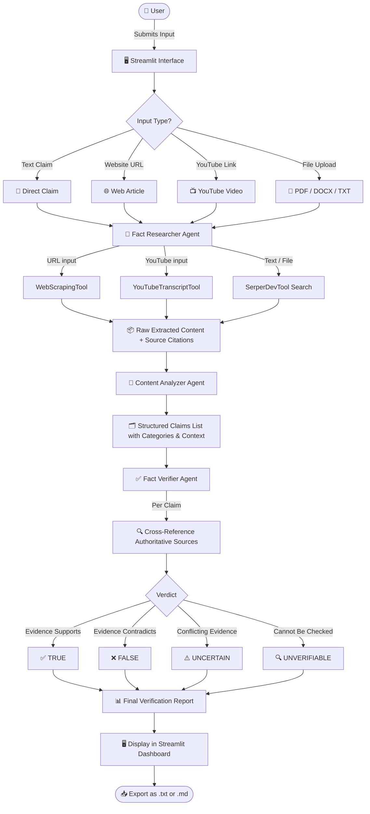

<div align="center">

# 🔍 TruthLens

### *"See Through the Noise. Know the Truth."*

[](https://www.python.org/)
[](https://crewai.com/)
[](https://streamlit.io/)
[](https://openai.com/)
[](LICENSE)
[]()

</div>

---

## 📋 Table of Contents

1. [Introduction](#-introduction)
2. [App Architecture](#-app-architecture)
3. [System Architecture & Details](#-system-architecture--details)
4. [How It Works — Workflow Diagram](#-how-it-works--workflow-diagram)
5. [Installation](#-installation)
6. [Environment Setup](#-environment-setup)
7. [How to Run the App](#-how-to-run-the-app)
8. [Example Usage](#-example-usage)
9. [Tech Stack](#-tech-stack)
10. [Author](#-author)

---

## 🌟 Introduction

**TruthLens** is an intelligent, multi-agent AI fact-checking system designed to combat misinformation across the digital landscape. In an era where false claims spread faster than corrections, TruthLens provides an automated, evidence-based verification pipeline that processes diverse content formats — from direct text claims and web articles to YouTube videos and uploaded documents.

Built on the **CrewAI** multi-agent framework and powered by **OpenAI GPT-4o**, TruthLens deploys a team of three specialized AI agents that work in concert: researching sources, analyzing claims, and delivering structured, confidence-scored verdicts through an intuitive **Streamlit** web interface.

### ✨ Key Highlights

| Feature | Description |
|---|---|
| 🤖 **Multi-Agent Intelligence** | Three specialized AI agents work sequentially for deep, layered verification |
| 📥 **Multi-format Input** | Supports text claims, web URLs, YouTube videos, and PDF/DOCX/TXT file uploads |
| ✅ **Structured Verdicts** | Clear `TRUE` / `FALSE` / `UNCERTAIN` / `UNVERIFIABLE` labels with confidence levels |
| 🔗 **Evidence-Backed** | Every verdict is supported by cited sources and traceable reasoning |
| 🌐 **Web App Interface** | Clean, professional Streamlit UI with real-time progress indicators |
| 📤 **Export Reports** | Download verification results as `.txt` or `.md` reports |

### 🎯 Who Is This For?

- **Journalists & Media Professionals** — Verify claims and sources before publication
- **Researchers & Academics** — Validate citations, study claims, and paper conclusions
- **Content Creators** — Ensure accuracy before sharing content with audiences
- **Educators** — Build information literacy and critical evaluation skills
- **General Public** — Independently verify claims encountered online

---

## 🏛 App Architecture

TruthLens is structured as a layered application with clear separation between the user interface, orchestration engine, and external integrations.

```
┌────────────────────────────────────────────────────────────┐
│                      TRUTHLENS APPLICATION                 │
│                                                            │
│  ┌──────────────────┐   ┌────────────────────────────┐    │
│  │  Streamlit       │   │   CrewAI Orchestration     │    │
│  │  Frontend        │──►│   Multi-Agent Pipeline     │    │
│  │  (app.py)        │   │   (crew.py)                │    │
│  └──────────────────┘   └────────────────────────────┘    │
│           │                          │                     │
│           ▼                          ▼                     │
│  ┌──────────────────┐   ┌────────────────────────────┐    │
│  │  Input Handler   │   │   Agent Pipeline           │    │
│  │  ─ Text Claim    │   │   ─ Fact Researcher        │    │
│  │  ─ URL           │   │   ─ Content Analyzer       │    │
│  │  ─ YouTube Link  │   │   ─ Fact Verifier          │    │
│  │  ─ File Upload   │   │                            │    │
│  └──────────────────┘   └────────────────────────────┘    │
│                                      │                     │
│                                      ▼                     │
│                         ┌────────────────────────────┐    │
│                         │   External Tools & APIs    │    │
│                         │   ─ WebScrapingTool        │    │
│                         │   ─ YouTubeTranscriptTool  │    │
│                         │   ─ FileReaderTool         │    │
│                         │   ─ SerperDevTool (opt.)   │    │
│                         │   ─ OpenAI GPT-4o          │    │
│                         └────────────────────────────┘    │
└────────────────────────────────────────────────────────────┘
```

### Project File Structure

```
fact_checker/                           # ── PROJECT ROOT ──────────────────────
├── app.py                              # Streamlit web application entry point
├── requirements.txt                    # Python dependencies
├── pyproject.toml                      # Build & CLI script configuration
├── .env                                # API keys (gitignored)
├── .gitignore
├── README.md                           # Project documentation
│
├── knowledge/
│   └── user_preference.txt             # CrewAI knowledge context
│
└── src/
    └── fact_checker/                   # ── PYTHON PACKAGE ────────────────────
        ├── __init__.py                 # Registered by pyproject.toml via src layout
        ├── crew.py                     # CrewAI crew, agents & task wiring
        ├── main.py                     # CLI entry point (run / train / replay / test)
        ├── show_tools.py               # Developer utility — lists registered tools
        │
        ├── config/
        │   ├── agents.yaml             # Agent roles, goals, backstories & LLM (gpt-4o)
        │   └── tasks.yaml              # Task descriptions & expected outputs
        │
        └── tools/
            ├── __init__.py             # Exports all three tools
            ├── web_scraping_tool.py    # URL content extractor (BeautifulSoup)
            ├── youtube_tool.py         # YouTube transcript extractor
            └── custom_tool.py          # FileReaderTool — PDF / DOCX / TXT parser
```

> **Why are there two folders both named `fact_checker`?**
>
> This is the **[PEP 517 `src` layout](https://packaging.python.org/en/latest/discussions/src-layout-vs-flat-layout/)** — an industry-standard Python packaging pattern generated by `crewai create crew fact_checker`. The same name is used at two entirely different levels:
>
> | Layer | Path | Purpose |
> |---|---|---|
> | **Project root** | `TruthLENS/fact_checker/` | Working directory — `app.py`, `.env`, `requirements.txt` live here. All commands (`streamlit run`, `pip install`) run from here. |
> | **Python package** | `fact_checker/src/fact_checker/` | The installable CrewAI Python package. `pyproject.toml` registers it so `from fact_checker.crew import FactChecker` resolves correctly inside `app.py`. |

---

## 🏗 System Architecture & Details

### Agent Layer — Three-Agent Pipeline

TruthLens runs a sequential three-agent pipeline powered by **CrewAI**. Each agent has a distinct role, toolset, and LLM binding (`gpt-4o`), and passes structured context to the next.

---

#### 🔎 Agent 1 — Fact Researcher (`fact_researcher`)

> *"Senior Fact Research Specialist"*

**Role:** Primary data gathering and evidence collection from all input sources.

**Goal:** Research and verify claims using multiple reliable sources including web search, document analysis, and content extraction from various formats.

**Tools Available:**
| Tool | Trigger Condition |
|---|---|
| `YouTubeTranscriptTool` | Input contains `youtube.com` or `youtu.be` |
| `WebScrapingTool` | Input is a regular webpage URL |
| `SerperDevTool` *(optional)* | Supplementary web search for any input type |

**Decision Logic:**
```python
if "youtube.com" in input or "youtu.be" in input:
    use YouTubeTranscriptTool()
elif is_url(input):
    use WebScrapingTool()
else:
    research_direct_claim_via_serper()
```

**Expected Output:**
- Extracted content (transcript, webpage text, or original claim)
- Key claims identified from the source
- Evidence gathered from multiple authoritative sources
- Source URLs and citations
- Preliminary assessment of claim validity

---

#### 🧩 Agent 2 — Content Analyzer (`content_analyzer`)

> *"Content Analysis Expert"*

**Role:** Parse and structure raw research into discrete, categorized, verifiable claims.

**Goal:** Analyze content from URLs, PDFs, documents, and YouTube videos to extract factual claims and verify their accuracy.

**Tools Available:** `YouTubeTranscriptTool`, `WebScrapingTool`

**Key Algorithms:**
- **NLP Processing** — Factual statement identification and boundary detection
- **Named Entity Recognition (NER)** — Key entity and fact extraction
- **Dependency Parsing** — Structural analysis of claim relationships
- **Semantic Analysis** — Claim significance scoring and prioritization

**Structured Output Format:**
```json
{
  "claims": [
    {
      "id": "claim_001",
      "text": "Extracted claim text",
      "category": "statistical | factual | opinion",
      "confidence": 0.85,
      "context": "Surrounding narrative context",
      "entities": ["entity1", "entity2"]
    }
  ]
}
```

---

#### ✅ Agent 3 — Fact Verifier (`fact_verifier`)

> *"Fact Verification Specialist"*

**Role:** Final authority on fact verification — cross-reference claims against evidence and assign definitive truth labels.

**Goal:** Make final determinations on whether claims are TRUE or FALSE based on comprehensive research and evidence analysis.

**Tools Available:** `SerperDevTool` *(when available)*

**Verification Process:**
1. **Source Identification** — Locate relevant authoritative sources for each claim
2. **Evidence Extraction** — Gather supporting or contradicting evidence
3. **Credibility Assessment** — Evaluate source reliability and domain authority
4. **Truth Determination** — Assign structured truth label
5. **Confidence Scoring** — Quantify certainty on a `High / Medium / Low` scale

**Truth Categories:**

| Label | Meaning |
|---|---|
| ✅ **TRUE** | Claim is supported by reliable, verifiable evidence |
| ❌ **FALSE** | Claim is directly contradicted by reliable evidence |
| ⚠️ **UNCERTAIN** | Evidence is insufficient, ambiguous, or conflicting |
| 🔍 **UNVERIFIABLE** | Claim cannot be objectively fact-checked |

---

### Task Configuration (`config/tasks.yaml`)

| Task | Agent | Depends On |
|---|---|---|
| `research_task` | `fact_researcher` | — |
| `content_analysis_task` | `content_analyzer` | `research_task` |
| `verification_task` | `fact_verifier` | `research_task` + `content_analysis_task` |

Tasks execute **sequentially** (`Process.sequential`) with full context passing between each stage.

---

### Tool Details

#### 🌐 WebScrapingTool
- **Libraries:** `requests`, `beautifulsoup4`, `lxml`, `trafilatura`, `newspaper3k`
- Extracts clean article text from any public URL
- Strips ads, navbars, and boilerplate content
- Collects metadata: title, author, publication date

#### 📺 YouTubeTranscriptTool
- **Libraries:** `youtube_transcript_api`, `urllib.parse`
- Extracts video ID from YouTube URLs (`youtube.com/watch?v=` and `youtu.be/` formats)
- Retrieves timestamped transcripts with auto-generated caption fallback
- Formats output for clean downstream claim extraction

#### 🔍 SerperDevTool *(Optional)*
- **Source:** `crewai-tools` package
- Google-powered real-time web search via [Serper.dev](https://serper.dev) API
- Used by both `fact_researcher` and `fact_verifier` agents
- Gracefully disabled when `SERPER_API_KEY` is not set

---

## 🔄 How It Works — Workflow Diagram



---

## 🛠 Installation

### Prerequisites

Ensure you have the following installed before proceeding:

| Requirement | Version |
|---|---|
| Python | `>= 3.10, < 3.14` |
| pip | Latest |
| Git | Any recent version |

### Step 1 — Clone the Repository

```bash
git clone https://github.com/likhiththallam/TruthLens.git
cd TruthLens/fact_checker
```

### Step 2 — Create a Virtual Environment with Python 3.11

```powershell
# Windows (recommended)
py -3.11 -m venv .venv
.venv\Scripts\activate
```

```bash
# macOS / Linux
python3.11 -m venv .venv
source .venv/bin/activate
```

> **Why Python 3.11?** TruthLens requires `>=3.10, <3.14`. Python 3.11 has the widest pre-built wheel support for all dependencies.

### Step 3 — Install Dependencies

```bash
pip install -r requirements.txt
```

> **Note:** To use the CrewAI CLI commands (`fact_checker`, `run_crew`, `train`, `replay`, `test`), also install in editable mode:
> ```bash
> pip install -e .
> ```

---

## ⚙️ Environment Setup

TruthLens uses environment variables to manage API keys securely. Create a `.env` file in the `fact_checker/` directory:

```bash
# Create the .env file
touch .env   # macOS/Linux
# OR on Windows:
type nul > .env
```

Add the following keys to your `.env` file:

```env
# ─────────────────────────────────────────────
# REQUIRED — OpenAI API Key
# Get yours at: https://platform.openai.com/api-keys
# ─────────────────────────────────────────────
OPENAI_API_KEY=sk-your-openai-api-key-here

# ─────────────────────────────────────────────
# OPTIONAL — Serper.dev API Key
# Enables real-time Google search for agents
# Get yours at: https://serper.dev
# TruthLens works without this, but verification
# accuracy improves significantly with it enabled.
# ─────────────────────────────────────────────
SERPER_API_KEY=your-serper-api-key-here
```

> ⚠️ **Security:** Never commit your `.env` file to version control. It is already listed in `.gitignore`.

---

## 🚀 How to Run the App

### Launch the Streamlit Web App

From within the `fact_checker/` directory:

```powershell
# Windows (using the virtual environment)
.venv\Scripts\streamlit run app.py
```

```bash
# macOS / Linux
source .venv/bin/activate
streamlit run app.py
```

The app opens automatically in your browser at:

```
http://localhost:8501
```

### Alternative — Run via CrewAI CLI

If installed with `pip install -e .`:

```bash
# Run the fact-checking crew directly (no UI)
fact_checker

# Or use the alias
run_crew
```

---

## 💡 Example Usage

### 1. Verify a Direct Text Claim

1. Open the app at `http://localhost:8501`
2. Select **📝 Text Claim** from the input mode options
3. Enter your claim in the text area, e.g.:

   ```
   The Great Wall of China is visible from space with the naked eye.
   ```

4. Click **🚀 Launch Professional Analysis**
5. TruthLens will return:
   - **Verdict:** `❌ FALSE`
   - **Explanation:** Evidence from NASA and multiple astronaut accounts confirms the wall is too narrow to be visible from low Earth orbit without optical aids.
   - **Sources:** Cited URLs from authoritative references

---

### 2. Fact-Check a News Article URL

1. Select **🌐 Website URL**
2. Paste a URL, e.g.:
   ```
   https://www.bbc.com/news/science-environment-56901261
   ```
3. TruthLens scrapes the article, extracts all factual claims, and verifies each one against authoritative sources.

---

### 3. Analyze a YouTube Video

1. Select **📺 YouTube Video**
2. Paste a YouTube link, e.g.:
   ```
   https://www.youtube.com/watch?v=dQw4w9WgXcQ
   ```
3. TruthLens retrieves the video transcript and runs the full fact-checking pipeline on the spoken claims.

---

### 4. Upload a Document

1. Select **📄 Document Upload**
2. Upload a `.pdf`, `.docx`, or `.txt` file containing the claims you want verified
3. TruthLens extracts the text, identifies claims, and produces a full verification report

---

### Sample Output Report

```
════════════════════════════════════════════════════
TRUTHLENS VERIFICATION REPORT
════════════════════════════════════════════════════

CLAIM 1: "The Great Wall of China is visible from space."
VERDICT: ❌ FALSE  |  Confidence: HIGH

Reasoning:
  Multiple NASA sources and astronaut testimony confirm the Great Wall
  is approximately 9 meters wide — far too narrow to resolve with the
  naked eye from an altitude of 400km (ISS orbit).

Sources:
  - https://www.nasa.gov/vision/space/workinginspace/great_wall.html
  - https://earthobservatory.nasa.gov/images/...

════════════════════════════════════════════════════
Summary: 1 claim verified | 1 FALSE | 0 TRUE | 0 UNCERTAIN
```

---

## 🧰 Tech Stack

### Core Frameworks

| Technology | Version | Role |
|---|---|---|
| **Python** | `>=3.10` | Primary language |
| **CrewAI** | `>=0.60.0` | Multi-agent orchestration & task management |
| **Streamlit** | Latest | Web application frontend |
| **OpenAI GPT-4o** | via API | LLM powering all three agents |

---

### AI & LLM Libraries

| Library | Purpose |
|---|---|
| `crewai` | Agent creation, task definition, crew execution |
| `crewai-tools` | SerperDevTool and other pre-built integrations |
| `langchain` | LLM integration and prompt chain management |
| `langchain-openai` | OpenAI-specific LangChain adapter |
| `openai` | Direct OpenAI API access |

---

### Web & Content Processing

| Library | Purpose |
|---|---|
| `requests` | HTTP client for web scraping |
| `beautifulsoup4` | HTML parsing and content extraction |
| `lxml` | Fast XML/HTML parser backend |
| `trafilatura` | Smart article text extraction |
| `newspaper3k` | News article metadata parsing |
| `youtube_transcript_api` | YouTube transcript and caption retrieval |
| `html5lib` | Standards-compliant HTML5 parser |

---

### Document Processing

| Library | Purpose |
|---|---|
| `PyPDF2` | PDF text extraction from uploaded files |
| `python-docx` | Microsoft Word (`.docx`) document parsing |
| `markdown` | Markdown-to-HTML conversion for exports |

---

### Data & Utilities

| Library | Purpose |
|---|---|
| `pydantic` | Data validation and schema enforcement |
| `python-dotenv` | Secure environment variable loading |
| `tenacity` | Retry logic for transient API failures |
| `aiohttp` | Asynchronous HTTP for concurrent requests |
| `validators` | URL and input format validation |

---

### Infrastructure

| Technology | Purpose |
|---|---|
| `hatchling` | Python package build backend (via `pyproject.toml`) |

---

### External APIs

| API | Required | Purpose |
|---|---|---|
| **OpenAI API** | ✅ Required | Powers all three GPT-4o agents |
| **Serper.dev** | ⚡ Optional | Real-time Google search for evidence gathering |
| **YouTube Transcript API** | ✅ Built-in | Video transcript retrieval (no key needed) |

---


| Technology | Purpose |
|---|---|
| `fastapi` | Optional REST API layer for programmatic access |
| `uvicorn` | ASGI server for FastAPI deployment |
| `hatchling` | Python package build backend |

---

## 👤 Author

<div align="center">

### Likhith Thallam

*AI/ML Intern · AI Developer · Open Source Contributor*

[](https://github.com/likhiththallam)

---

*TruthLens was built as a demonstration of modern agentic AI systems applied to a critical real-world problem — combating misinformation through intelligent, multi-source verification pipelines.*

**TruthLens — See Through the Noise. Know the Truth.** 🔍

</div>

---

<div align="center">

**MIT License** · Copyright © 2026 Likhith Thallam

</div>